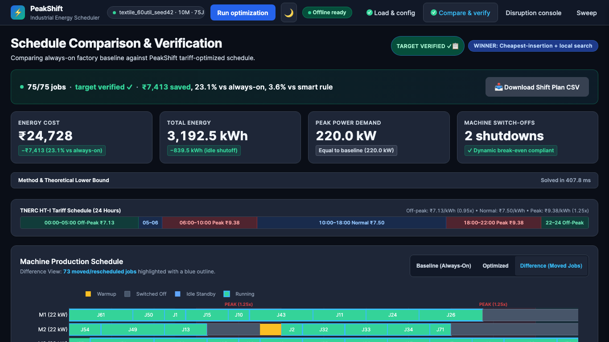
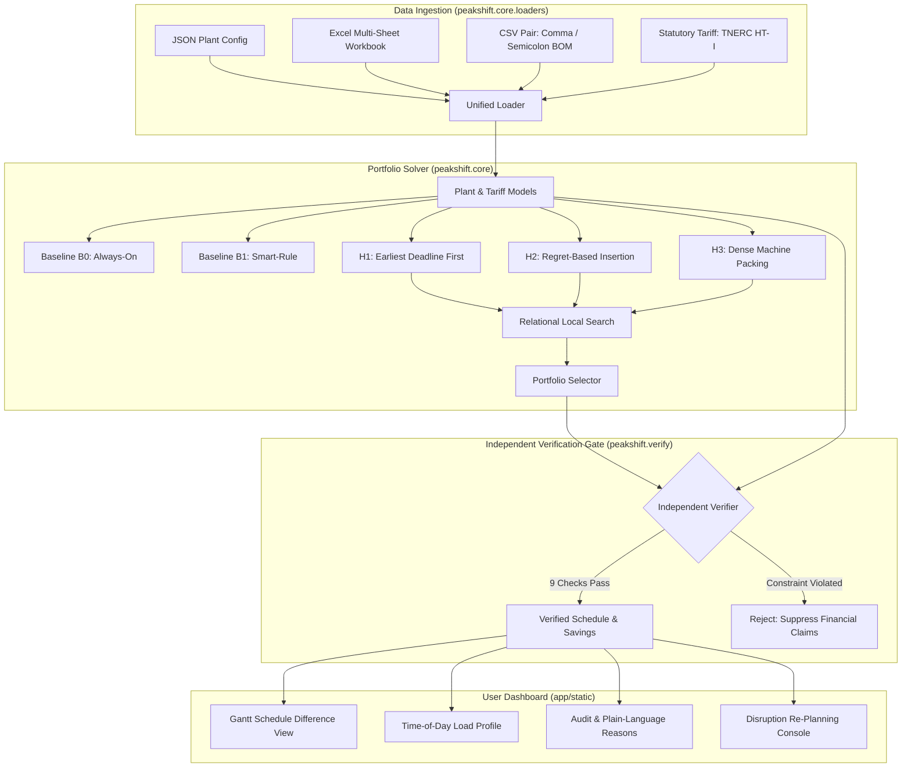

# PeakShift

PeakShift is an open-source, energy-aware industrial production scheduling platform that shifts factory load away from expensive peak electricity tariff windows. An independent verifier checks deadline compliance, machine conflicts, and downtime blackouts on every schedule. Operating entirely offline without external cloud dependencies, it combines multi-heuristic constructive search, relational local optimization, and an independent physical constraint verifier. Energy cost savings against an always-on baseline range from about 3% near full load to about 50% at light load; the exact figures for each test case are in [test_cases/RESULTS.md](test_cases/RESULTS.md).



---

## Key Features

- **Multi-Heuristic Portfolio Optimizer**: Concurrently generates schedules using three constructive strategies (Tariff-Aware Early Dispatch, Priority Regret Insertion, and Dense Machine Packing) refined via relational local search.
- **Dual Physical Baselines (B0 & B1)**: Evaluates savings against both an Always-On baseline ($B_0$, keeping machines idling) and a Smart-Rule baseline ($B_1$, greedy gap shutdown).
- **Independent 9-Point Verifier Gate**: A detached validation module with zero solver imports re-computes all physical constraints (non-overlap, release/deadline windows, machine affinities, downtime blackouts, warm-up, switch limits, contract demand, and exact financials).
- **Resilient Mid-Day Re-Planner**: Freezes completed production and re-plans remaining jobs in about a third of a second on a 10-machine plant (measured 0.27 s) when handling machine breakdowns, rush orders, or tariff shocks.
- **Multi-Format Data Ingestion**: Directly uploads factory topologies via JSON, multi-sheet Excel (`.xlsx`), or dual CSV pairs (supporting Western European semicolons and UTF-8 BOM).
- **Zero-Cloud & CDN-Free**: Completely self-contained frontend with embedded Plotly.js visualization, local typography, and no telemetry calls.

---

## Quickstart

Run PeakShift locally in three commands:

```bash
# 1. Create and activate a virtual environment
python3 -m venv .venv && source .venv/bin/activate

# 2. Install dependencies
pip install -r requirements-dev.txt

# 3. Start the application
uvicorn peakshift.api.main:app --host 0.0.0.0 --port 8000
```

Open [http://127.0.0.1:8000](http://127.0.0.1:8000) in your browser.

To run the complete test suite:
```bash
pytest
```

To run end-to-end browser upload checks across all ten test cases:
```bash
node scripts/e2e_upload_check.js http://127.0.0.1:8000
```

---

## Ten Authoritative Test Cases

PeakShift includes ten deterministically generated test cases in `test_cases/` illustrating diverse industrial sectors, file formats, and constraint scenarios.

Detailed execution benchmarks are available in [test_cases/RESULTS.md](test_cases/RESULTS.md).

| Case | Scenario | Format | Key Characteristics | Expected Outcome |
|---|---|---|---|---|
| **TC01** | Textile Mill Standard | JSON | 10 machines, 60% load factor, seed 42 | Target met, verifier green, >20% savings vs $B_0$ |
| **TC02** | Machining Workshop | Excel (`.xlsx`) | 8 machines, multi-sheet workbook (`machines`, `jobs`) | Target met, verifier green, sheets auto-parsed |
| **TC03** | Food Processing Lines | CSV Pair | Comma-separated `machines.csv` and `jobs.csv` | Target met, verifier green, dual CSV validated |
| **TC04** | European Textile Export | Semicolon CSV | Semicolon delimiters with UTF-8 BOM (`\ufeff`) | Delimiter auto-detected, target met, verifier green |
| **TC05** | Complete Feature Showcase | JSON | 3 machines, 10 jobs, planned downtime, warm-up, switch caps | Target met, verifier green, compact demonstration |
| **TC06** | Outage & Priority Windows | JSON | High load (0.8); machine M3 down slots 20–28; 3 urgent orders | Target met, zero jobs on M3 during outage, urgent jobs placed |
| **TC07** | Low Load Peak Shifting | JSON | Textile mill at 30% load factor | Target met, ~50% energy savings by switching idle machines off during light load |
| **TC08** | Overloaded Capacity Alert | JSON | 10 jobs of 12 slots on 2 machines (120 slots needed > 96 cap) | "Target at risk" banner with unplaced jobs; never reports false success |
| **TC09** | Missing Column Validation | CSV Pair | Machines CSV missing required `restart_kwh` column | HTTP 422; readable error stating missing column |
| **TC10** | Machine Affinity Validation | JSON | Job restricted to non-existent machine `M99` | HTTP 422; readable error naming job `J5` and machine `M99` |

---

## Uploading your own data

On the **Load & config** page choose a file (or select both files for CSV) and press **Run optimization**. A complete specification is available in [docs/UPLOAD_FORMAT.md](docs/UPLOAD_FORMAT.md).

| Format | What to select | Notes |
|---|---|---|
| JSON | one `.json` file | whole plant in one file; the only format that can change the horizon or slot length |
| Excel | one `.xlsx` file with two sheets named `machines` and `jobs` | |
| CSV | two files together: a machines file and a jobs file | comma or semicolon separated, UTF-8 with or without BOM |

**Time.** One slot is 30 minutes and the horizon is 48 slots (24 hours) for CSV and Excel. Slot 0 is 00:00, so a job running slots 4 to 8 runs from 02:00 to 04:00. `deadline_slot` is exclusive. In JSON you can set `horizon_slots` and `slot_minutes` (60 must divide evenly by `slot_minutes`; the horizon can be at most 3 days).

**Machines**

| Column | Required | Meaning | Default |
|---|---|---|---|
| `id` | yes | unique name, for example `M1` | |
| `run_kw` | yes | power while running (kW) | |
| `idle_kw` | yes | power while on but idle (kW) | |
| `restart_kwh` | yes | energy to start again after switching off (kWh) | |
| `warmup_slots` | no | slots needed to warm up before running after a restart | 0 |
| `min_off_slots` | no | shortest gap worth switching off for | 0 |
| `max_switch_cycles` | no | most switch-offs allowed in the horizon (empty means no limit) | none |
| `initial_state` | no | `idle` or `off` at slot 0 | `idle` |
| `downtime` | no | unavailable slots as `start-end`, several separated by `;`, for example `10-14;30-34` | none |

**Jobs**

| Column | Required | Meaning | Default |
|---|---|---|---|
| `id` | yes | unique name, for example `J1` | |
| `duration_slots` | yes | length in slots (4 slots = 2 hours) | |
| `release_slot` | no | earliest start slot | 0 |
| `deadline_slot` | no | the job must finish by this slot | end of horizon |
| `allowed_machines` | no | machines that may run it, separated by `;` (empty means any) | any |
| `priority` | no | higher number is scheduled first | 0 |
| `units` | no | units produced (used for the production target) | 1 |
| `mandatory` | no | `true` or `false` | true |

**Smallest working examples** are in `templates/`: `minimal_machines.csv` with `minimal_jobs.csv`, `minimal_plant.json`, and `minimal_plant.xlsx`; the `full_*.csv` pair shows every column.

**Rules the file must follow:** ids are unique; every machine in `allowed_machines` exists in the machines list; `release_slot` is smaller than `deadline_slot`; the duration fits inside that window; the deadline is within the horizon; there is at least one machine and one job.

**What you get.** A schedule with a green "target verified" line when every job fits. If the jobs need more machine time than exists, the app shows "Target at risk" and lists the jobs it could not place instead of pretending it succeeded.

**Common messages**

| Message | Cause | Fix |
|---|---|---|
| `machines file: missing column 'restart_kwh'` | a required column is missing or misspelled | add the column; names are not case sensitive |
| `jobs file: missing column 'duration_slots'` | same, for jobs | add the column |
| `CSV uploads require both machines and jobs files` | only one CSV was selected | select both files together |
| `Job J5: machine 'M99' does not exist` | `allowed_machines` names an unknown machine | correct the name or add the machine |
| `Job J3: release slot 30 is after deadline slot 20` | the window is backwards | swap or correct the slots |
| `Job J7: duration (10) larger than feasible window (6)` | the job cannot fit in its window | widen the window or shorten the job |
| `Duplicate machine id` or `Duplicate job id` | two rows share an id | make ids unique |
| `slot_minutes must divide 60 evenly` | for example 25 minutes | use 5, 10, 15, 20, 30 or 60 |
| `Horizon length exceeds maximum 3 days` | too many slots | reduce `horizon_slots` |
| `Cannot connect to backend server` | the server is not running | start it with the command in Quick start |


---

## System Architecture



---

## How Baselines Are Defined

To prevent overstated or ungrounded claims, PeakShift measures savings against two transparent, reproducible benchmarks:

1. **Baseline B0 (Always-On Dispatch)**:
   - Jobs are scheduled by arrival order to the earliest available machine.
   - Machines remain powered on and idling continuously during gaps ($0\text{ kW}$ shut-offs). This reflects the default operational mode of many conventional factories.
2. **Baseline B1 (Smart-Rule Dispatch)**:
   - Preserves identical job placements as $B_0$.
   - Applies an automatic break-even rule: powers down a machine during any idle gap where the standby energy cost exceeds the restart energy penalty.
   - **Mathematical Guarantee**: $\text{Cost}(B_1) \le \text{Cost}(B_0)$.

PeakShift reports savings against both $B_0$ and $B_1$. Savings from shifting alone without shutdown are modest (typically 2% to 5%); substantial savings arise from coordinating job shifts to create contiguous idle intervals eligible for power-down.

---

## Electricity Tariff Specification

PeakShift implements the statutory industrial Time-of-Day (ToD) tariff structure established by the **Tamil Nadu Electricity Regulatory Commission (TNERC) Tariff Order No. 6 of 2025 for HT-I Industrial Consumers**:

- **Base Energy Charge**: ₹7.50 / kWh
- **Morning Peak Window (06:00 – 10:00)**: +25% surcharge (₹9.38 / kWh)
- **Evening Peak Window (18:00 – 22:00)**: +25% surcharge (₹9.38 / kWh)
- **Night Off-Peak Window (22:00 – 05:00)**: 5% rebate (₹7.13 / kWh)
- **Normal Daytime Window (05:00 – 06:00, 10:00 – 18:00)**: Base rate (₹7.50 / kWh)
- **Statutory Electricity Tax**: 5.0%
- **Contract Demand Charge**: ₹608 / kVA / month with 90% recorded demand billing floor.

The tariff model is fully editable via `data/tariffs/tn_ht1.json` or interactively through the dashboard.

---

## Limitations & Modeling Assumptions

- **Discrete Time Slots**: Factory operations are discretized into 30-minute intervals (configurable down to 5 minutes, provided it divides 60 evenly).
- **Lumped Thermal Restart Energy**: Cold machine restarts are modeled with fixed transition energy ($\text{kWh}$) and warm-up slots rather than continuous non-linear thermal cooling differential equations.
- **Single-Stage Production Steps**: Work orders are evaluated as independent operations with machine compatibility rather than complex multi-echelon job-shop networks with buffer interlocks.
- **Synthetic Industrial Profiles**: Operational parameters (run kW, idle kW, restart kWh) are synthesized from peer-reviewed industrial energy studies to reflect realistic textile, machining, and food processing lines.
- **Re-Planner Scope**: After a machine failure the re-planner may also move some jobs that were not on the failed machine when that saves cost overall; the counts of forced and optional moves are shown on the Disruption page.

---

## License & Acknowledgements

This project is licensed under the [MIT License](LICENSE).

- **Third-Party Licenses**: Detailed font and library notices are documented in [THIRD_PARTY_NOTICES.md](THIRD_PARTY_NOTICES.md).
- **Regulatory Framework**: Tamil Nadu Electricity Regulatory Commission (TNERC) Tariff Order No. 6 of 2025.
- **Reference Literature**:
  - Pinedo, M. L. (2016). *Scheduling: Theory, Algorithms, and Systems*. Springer.
